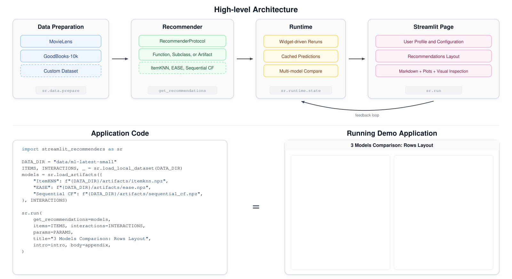
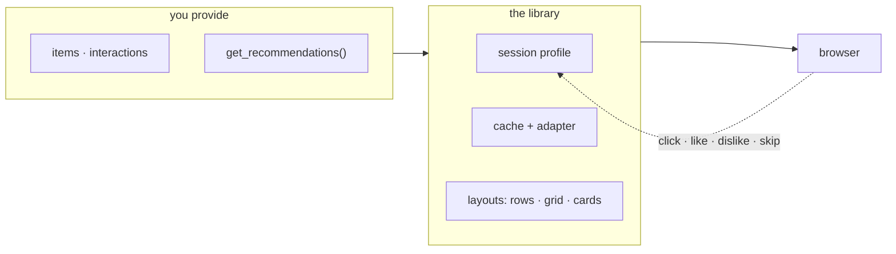
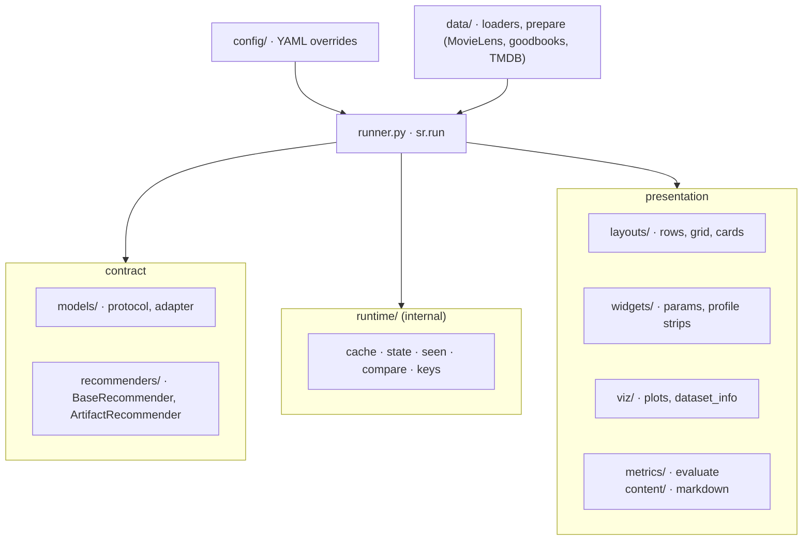

# Architecture

## The session loop

You provide the tables and a recommender. The library keeps the session profile, calls the
recommender through a cache, and renders the result. Clicks, likes, dislikes and skips go back
into the profile, and the next refresh scores against it.

One refresh: sidebar params and the selected user go to the cached `get_recommendations()`
(through the adapter, which drops arguments the function does not declare); the returned ids are
stored per section in session state and rendered. **Get Recommendations** recomputes every section
against the same profile, which is what makes compared models comparable.

## Module map

Training is deliberately outside: the library standardizes how a trained recommender is shown and
probed, not how it is trained.
